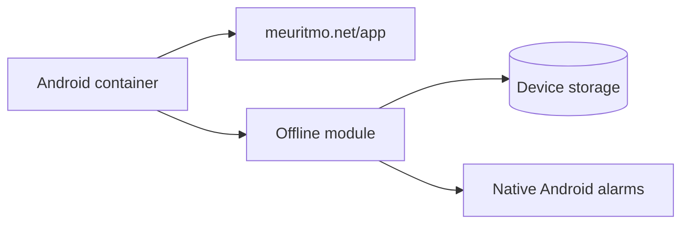

# Meu Ritmo App — engineering quality / engenharia
Owner and maintainer: João Victor da Silva (JustJao1).
EN: Android companion for the online Meu Ritmo platform with local notes and native alarms.
PT: Aplicativo Android para Meu Ritmo, com notas locais e alarmes nativos.

ADR-001: Separate online account records from local offline records; do not claim automatic synchronization. ADR-002: Native alarms depend on device permissions and power settings. ADR-003: Updates must use the existing private release signing key; never include it in the repository.
## Verify / validar
See README, tests and [existing workflows](https://github.com/JustJao1/meu-ritmo-app/actions). Android device/emulator checks and release signing require the authorized toolchain and a test device. A general web Docker container does not validate native Android behavior.
## Demo (EN)
Open the online screen with an approved test account; then switch to offline notes, create a fictional note and configure a test alarm. Explain the offline boundary and permissions. Do not publish a new APK without authorized signing.
## Demonstração (PT)
Abra a tela online com conta de teste autorizada; depois use notas offline e configure um alarme de teste. Explique limites de sincronização e permissões.
## AI-assisted review
Review native permissions, WebView boundaries, versioning and build evidence. Do not share signing keys or personal information. Test on physical devices before release; historical changes are not certified by this policy.
